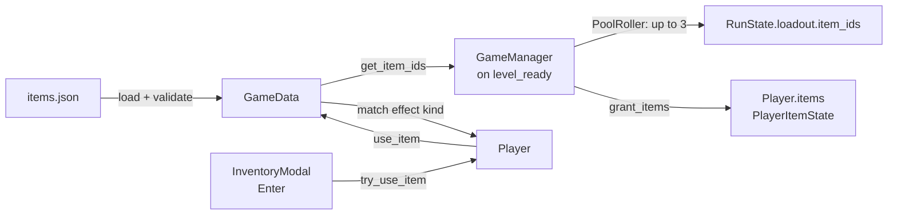

# Equipment

Every run deals the goblin up to **3 items**, listed under EQUIPMENT on the reveal screen. **I** opens the inventory at any time for free. Press an item's number to read it, and **Enter** to use it. Using an item costs exactly one turn, and an item with no charges left disappears. Today the only built item is the **Blueprint**, which maps the floor's layout.

## How it works

Items follow the same pipeline as traits ([traits-and-gamedata.md](traits-and-gamedata.md)): data in JSON, validated by `GameData`, dispatched on an effect kind, with no code anywhere else branching on an item id. The schema and every item's definition are in [design/items.md](../design/items.md).

1. **Load.** At startup `GameData` reads `items.json` through the same loader as traits. An unknown `action` or effect `kind`, or fewer than 1 charge, is logged and the item dropped.
2. **Roll.** On `level_ready`, `GameManager` rolls `Constants.STARTING_ITEM_COUNT` distinct ids from every valid item with `PoolRoller`. The roll is capped at the pool size, so with one built item every run deals exactly that one. The ids go on `RunState.loadout.item_ids`, and the reveal screen lists them.
3. **Grant.** `GameData.grant_items()` gives each item to `Player.items` (a `PlayerItemState`) with its starting charges.
4. **Use.** In the inventory, Enter calls `Player.try_use_item(id)`. It refuses, spending nothing, if the goblin is asleep, the run is over, or it isn't the player's turn. The inventory stays open in that case. Otherwise it:
   - begins the turn like a bump does: the pre-move guard sighting check runs ([0009](../decisions/0009-sighting-checked-before-player-moves.md)), and the turn doesn't count as a wait, so Statue doesn't apply;
   - runs the effect through `GameData.use_item()`, an authored `match` on the effect kind;
   - spends a charge, dropping the item at zero;
   - ends the turn. Turn-end chances (Allergies, Narcolepsy) roll as on every spent turn ([0005](../decisions/0005-turn-end-chance-rolls-every-spent-turn.md)), and the world takes its turn.

   A use is neither a move nor a wait, so it makes no step noise and no smell, and Fidgety doesn't fire. Vision isn't recomputed, as on a bump.

### The Blueprint (`map_floor`)

`Player.map_floor()` asks `TileManager` for every cell with terrain on the current floor and hands them to `PlayerFov.map()`. Each cell the goblin has never seen becomes **`MAPPED`**. Seen cells, visible or remembered, are untouched. The result goes out as an ordinary vision update.

`MAPPED` tiles look like remembered ones (dimmed to 40%). Unlike remembered cells, a mapped cell shows nothing standing on it, since the goblin has never seen it. The only exceptions are entities that are part of the layout (`Entity.is_layout`, set by doors). A mapped door is drawn dimmed and closed: it has never been seen, so its frozen sprite is still the closed one it starts with ([doors.md](doors.md)). Once the goblin actually sees a mapped cell, it becomes `VISIBLE` and then `REMEMBERED` like any other. Why this is its own state: [0021](../decisions/0021-mapped-is-its-own-vision-state.md).

### The inventory screen

`InventoryModal` and `TraitsModal` share a base, `ListModal`: a `CanvasLayer` with a numbered list, a detail panel, and a toggle key. It opens only when no other modal is open, and it holds `UiState.modal_open` while it's showing. The inventory adds Enter and a usage line (`Charges: 1`, `Enter: use`). It shows "Your pockets are empty." when nothing's left.

## Key pieces

| Piece | Where | Role |
|---|---|---|
| `items.json` | [`project/data/items.json`](../../project/data/items.json) | Built items only |
| `GameData` item API | [`autoloads/game_data.gd`](../../project/autoloads/game_data.gd) | `KNOWN_ITEM_ACTIONS`, `KNOWN_ITEM_EFFECT_KINDS`, `get_item_definition()`, `get_item_ids()`, `grant_items()`, `use_item()` |
| `PlayerItemState` | [`util/actors/player/player_item_state.gd`](../../project/scripts/util/actors/player/player_item_state.gd) | Held ids in roll order, charges, `spend_charge()` |
| `Player.try_use_item()` / `map_floor()` | [`actors/player.gd`](../../project/scripts/actors/player.gd) | Spending the turn; the Blueprint's effect |
| `PlayerFov.map()` / `VisionState.MAPPED` | [`util/actors/player/player_fov.gd`](../../project/scripts/util/actors/player/player_fov.gd) | Marking never-seen cells as mapped |
| `TileManager.get_layout_cells()` | [`autoloads/tile_manager.gd`](../../project/autoloads/tile_manager.gd) | Every cell with terrain on the current floor |
| `ListModal` / `InventoryModal` | [`ui/list_modal.gd`](../../project/scripts/ui/list_modal.gd), [`ui/inventory_modal.gd`](../../project/scripts/ui/inventory_modal.gd) | The **I** screen |

## Extending it

- **A new item using an existing effect kind** is data only: add it to `items.json` and [design/items.md](../design/items.md). It joins the roll pool automatically.
- **A new effect kind** takes three touches: its name in `KNOWN_ITEM_EFFECT_KINDS`, one branch in `GameData.use_item()` that tells the owner of the effect what to do (an entity's own method, or a manager), and a row in [design/items.md](../design/items.md). Keep the effect's text, radii and durations in its JSON parameters.
- **A new action** (`throw` in Wave 1): add it to `KNOWN_ITEM_ACTIONS` and give `InventoryModal` the step it needs before calling the player (choosing a target cell). The `Enter: <action>` line already comes from data.
- **Something else that should show on mapped cells** (stairs, an exit): set `is_layout = true` on it.

## Gotchas

- **Eavesdropper still works on mapped cells.** A guard heard through walls shows its `?` on a mapped cell just as it would on a never-seen one. The Blueprint itself reveals no guards.
- **The inventory can open over the end screen,** because the end screen doesn't hold the modal flag ([bug-08](../bugs/bug-08-modal-flag-not-reset-or-claimed.md)). Enter does nothing there, since the run is over.
- **The list is a snapshot.** The inventory reads the held items when it opens. Nothing changes them while it's open, because using an item closes it.

## Not built yet

- **Throwing and aiming,** `Player.throw_range` (Pitcher, Butterfingers), and used items that pick a direction: Wave 1 of the [Equipment epic](../stories/equipment-epic.md).
- **Every other item:** see the epic's roadmap.
- **Mapping another floor:** "the current floor" is the whole map until two floors exist.
- **Juice on use:** see [design/items.md → Open items](../design/items.md#open-items).

---
*Last verified against code: `f924e6c` (+ the feature/equipment-item-system branch) on 2026-10-29.*
