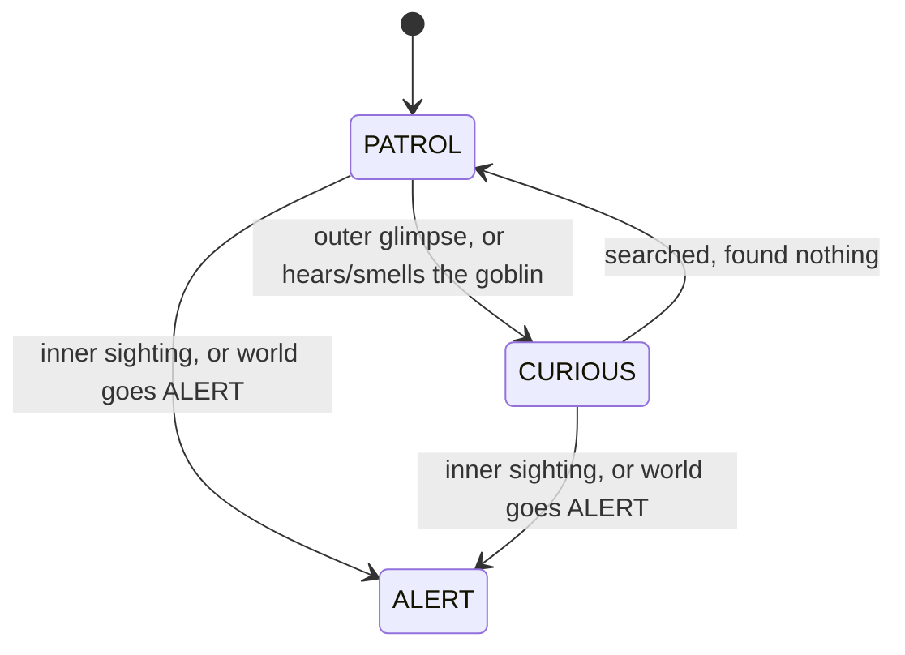

# Guards

Guards wander the mansion looking for the goblin. What they're doing shows in the color of their vision cone:
- **Green** (PATROL): wandering.
- **Yellow** (CURIOUS): checking out something they glimpsed or heard.
- **Red** (ALERT): hunting.

A guard that walks into the goblin, or that the goblin walks into, captures it and ends the run.

## How it works

### Vision: the cone

Each guard sees in two zones, measured in tiles (diagonals count as one):

| Zone | Range | Seeing the goblin here means |
|---|---|---|
| **Inner** (more opaque) | up to 3 tiles | Spotted, and the whole mansion goes to ALERT |
| **Outer** (fainter) | 4–6 tiles | A glimpse. The guard investigates |

- **Arc:** in PATROL, the cone is 55° wide and points the way the guard is walking. In CURIOUS and ALERT, the guard sees all the way around.
- **What blocks sight:** walls, and furniture that blocks vision. A closed or peeked door blocks a guard's sight.
- **ALERT cones** are drawn at one uniform intensity, without the inner/outer split.

### The three states

- **PATROL:** walks to a random reachable spot anywhere on the map, then picks another ([0008](../decisions/0008-patrol-routes-cut.md)).
- **CURIOUS:** remembers where it was, then walks to the **point of interest** (POI), the cell where it glimpsed or heard the goblin. When it arrives, it checks two more random spots within 3 tiles, then walks back to where it was and returns to PATROL. A fresh glimpse or noise while it's curious just moves the POI. If the POI can't be reached, it gives up straight away. Curiosity doesn't spread: other guards don't react.
- **ALERT:** every guard converges on the shared **last known position** (LKP), held by `WorldState`. The first guard to step onto the LKP clears it. After that, guards search erratically, picking random spots within 8 tiles of themselves, until someone sees or hears the goblin again and sets a new LKP. ALERT is **permanent for the run** ([0011](../decisions/0011-alert-is-permanent.md)): once the world is in ALERT, every guard switches to it, and nothing ever switches it back.

### What a sighting does

| Guard state | Inner-zone sighting | Outer-zone glimpse, noise, or smell |
|---|---|---|
| PATROL | World and guard go ALERT; LKP set | Guard goes CURIOUS; POI set |
| CURIOUS | World and guard go ALERT; LKP set | POI moved; re-path |
| ALERT | LKP updated | LKP updated |

The noise and smell columns come from the sound system: any guard inside the flood fill around the goblin reacts exactly as if it had glimpsed the goblin in its outer zone (`react_to_proximity()`).

Some traits bend these rules: Camouflage and Big Target shrink or grow the inner zone, Statue ignores the outer zone on turns you waited, and Disguise absorbs a sighting. See [traits-and-gamedata.md](traits-and-gamedata.md).

### Order within a turn

1. **Before the goblin's action resolves**, every guard checks whether the goblin's *current* cell is inside its current cones. So stepping out of a cone doesn't dodge a sighting you were already in ([0009](../decisions/0009-sighting-checked-before-player-moves.md)).
2. **The world turn:** each guard, in registration order:
   - switches to ALERT if the world is in ALERT;
   - recomputes its vision;
   - checks for the goblin;
   - acts for its state (one step);
   - recomputes its vision again, so the cone shows where it now looks.
3. After every guard has acted in ALERT, `WorldState` advances its LKP prediction (below).

### Predictive tracking

So guards don't give up the instant the goblin rounds a corner, they extrapolate ([0010](../decisions/0010-guards-predict-player-heading.md)). Every sighting records the goblin's heading, taken from any two sightings by that guard, not just consecutive turns, so one glimpse after an earlier one is enough. When sight is lost:

| | Who | How far | Around corners |
|---|---|---|---|
| **CURIOUS guard** | Each guard, its own POI | 1 cell per turn for 4 turns (+ Cold Trail / Persistent Trail modifiers) | Yes. If straight ahead is blocked, it tries the horizontal, then the vertical part of the heading |
| **World (ALERT)** | `WorldState`, the shared LKP | 1 cell per turn for 8 turns, skipped on any turn a guard has eyes on the goblin | No. It stops at the first blocked cell |

### Movement and capture

- **Paths** come from `TileManager`'s A* pathfinding, one step per turn, and the guard turns to face each step.
- **Blocked steps:** if the next cell is occupied, the guard drops its path and waits, then re-plans next turn. Guards never swap places.
- **Capture:** stepping into the goblin is allowed through, because the goblin is interactable, so a guard walking into the goblin captures it, the same as the goblin walking into a guard ([0013](../decisions/0013-bumping-is-how-actors-interact.md)).
- **Doors** don't stop guards: they walk through, and the door opens while they stand in it.

### What the player sees of guards

Guards are only drawn while their cell is in the goblin's view. They aren't remembered in fog of war. With Eavesdropper, a guard behind a wall within earshot shows as a `?` instead.

## Key pieces

| Piece | Where | Role |
|---|---|---|
| `Guard` | [`actors/guard.gd`](../../project/scripts/actors/guard.gd) | The body: facing, path, movement, vision zones, capture, visibility. Emits `cone_updated` for `VisionManager` |
| `GuardStateMachine` | [`util/actors/guard/guard_state_machine.gd`](../../project/scripts/util/actors/guard/guard_state_machine.gd) | All behavior: states, detection, POI search, per-guard tracking. Tuning constants at the top |
| `GuardFov` | [`util/actors/guard/guard_fov.gd`](../../project/scripts/util/actors/guard/guard_fov.gd) | Computes the inner and outer zones from position, facing and arc, with line-of-sight sampling |
| `StateMachine` | [`util/actors/state_machine.gd`](../../project/scripts/util/actors/state_machine.gd) | Generic enter/execute/exit state machine, meant for cameras and dogs too |
| `WorldState` | [`autoloads/world_state.gd`](../../project/autoloads/world_state.gd) | World alert level, the shared LKP, world-level tracking |
| `TurnManager` | [`autoloads/turn_manager.gd`](../../project/autoloads/turn_manager.gd) | Runs each guard's turn, then the world tracking tick |
| Pre-move check | `Player._check_guard_sighting()` → `Guard.check_immediate_sighting()` | Step 1 of the turn order above |

## Extending it

- **Tuning:**
  - **Vision:** ranges and arc are constants at the top of `GuardFov`.
  - **Behavior:** search, tracking and ALERT search range are constants at the top of `GuardStateMachine`.
  - **World:** world tracking length is in `WorldState`.
  - **Colors:** state colors are in `GuardStateMachine`.
- **A new guard type** (dogs per the GDD): reuse `Guard` and `GuardStateMachine`, and vary them through data or parameters, e.g. an unsegmented cone or a bigger hearing radius. Don't fork the class.
- **A new watcher** (cameras, lasers): build it on the generic `StateMachine`. Trip ALERT through `WorldState.set_lkp()`, the single place that both sets the LKP and puts the world into ALERT.
- **Anything that makes noise:** call `react_to_proximity(cell)` on guards inside a `ProximityAlert` flood. Don't add new reaction paths.

## Gotchas

- **The world goes ALERT immediately, not "next turn".** The GDD says guards switch "in the next turn". In the code, an inner sighting puts the world in ALERT at once. Guards later in this world turn's order switch this same turn, and earlier ones at the start of their next turn.
- **The two tracking layers behave differently.** Only CURIOUS tracking slides around corners and responds to Cold Trail / Persistent Trail. World tracking doesn't do either.
- **Patrol destinations are map-wide.** A patrolling guard can cross the whole map. Only ALERT searches are range-limited.
- **Arc parameter:** `GuardFov.compute()` takes an arc parameter, but the arc test itself always uses the `HALF_ARC_DEGREES` constant. Today only 55° and 360° are used, so it doesn't matter yet.

## Not built yet

- **Dogs:** no segmented cone, better hearing, can't open doors (GDD).
- **Doors stopping some guards:** humans are meant to open doors and dogs not; today every guard walks through.
- **Guards inspecting furniture and closets:** this depends on the furniture and hiding system.
- **Cameras and other watchers** that trip ALERT.
- **Guards speaking to each other as they pass:** juice, from the GDD.

---
*Last verified against code: `4822104` on 2026-10-28.*
