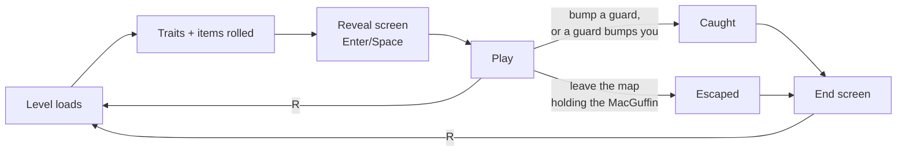

# Run Lifecycle

A run goes:
1. load the mansion;
2. deal the goblin its traits and show them;
3. sneak, grab the MacGuffin from its chest, and walk out;
4. or get caught.

Either ending freezes the game on an end screen, and **R** starts a fresh run at any time.

## How it works

### 1. Start

The game boots straight into the hand-built test mansion, [`scenes/levels/poc.tscn`](../../project/scenes/levels/poc.tscn); there's no main menu yet. Godot readies a scene's children before the scene itself, so by the time `Level._ready()` runs, the player, guards, doors and chest have all registered with their managers. `Level` then hands the floor and wall layers to `TileManager` and emits `GameEvents.level_ready`.

`GameManager` picks that up and deals the loadout (see [traits-and-gamedata.md](traits-and-gamedata.md)). It emits `loadout_rolled`, and the **reveal screen** opens. It lists the rolled traits under "TRAITS" (positive) and "FLAWS" (negative) and the items under "EQUIPMENT" ([equipment.md](equipment.md)), and blocks play until the player presses Enter or Space.

### 2. Play

The goblin's input is only accepted when three things are true:
- the run isn't over (`RunState.is_run_over`);
- no modal is open (`UiState.modal_open`);
- it's the player's turn.

Modals block input without costing a turn. Besides the reveal screen, **C** opens the traits screen (press a number for a trait's description, C again to close) and **I** opens the inventory, where Enter uses the inspected item for a turn. Each opens only when no other modal is open.

### 3. The MacGuffin

The MacGuffin sits in a chest. **Bumping** the chest picks it up, and the bump costs a turn like any other action ([0013](../decisions/0013-bumping-is-how-actors-interact.md)). With Cat Burglar, just passing orthogonally next to it is enough. `RunState.has_macguffin` records that you're holding it, and the chest shows open. Picking it up has no other effect yet.

### 4. Ending

- **Caught:** a guard and the goblin bump into each other, in either direction (see [guards.md](guards.md#movement-and-capture)). `RunState.lose()` is called, unless Slippery has a charge to spend.
- **Escaped:** walking off any edge of the map while holding the MacGuffin calls `RunState.win()` ([0015](../decisions/0015-escape-off-the-map-edge.md)). Walking off an edge without it just spends the turn.

Both go through `RunState`, which marks the run over, logs the outcome, and emits `GameEvents.run_ended(won, cause)`. From then on:
- `Player` ignores input;
- `TurnManager` refuses to run world turns;
- `Player.end_turn()` skips its turn-end chance effects.

The **end screen** shows "YOU ESCAPED" or "YOU WERE CAUGHT", plus the cause and "Press R to Restart" ([0014](../decisions/0014-run-state-and-restart-by-reload.md)).

### 5. Restart

**R** works at any moment, mid-run included. `GameManager` resets the autoloads that carry run state (`WorldState`, `RunState` and the guard cones in `VisionManager`), then reloads the scene. Everything else is rebuilt from scratch by the reload, including a fresh roll.

## Key pieces

| Piece | Where | Role |
|---|---|---|
| `Level` | [`level/level.gd`](../../project/scripts/level/level.gd) | Initializes `TileManager` and emits `level_ready` |
| `GameManager` | [`autoloads/game_manager.gd`](../../project/autoloads/game_manager.gd) | Rolls the loadout on `level_ready`; handles restart |
| `RunState` | [`autoloads/run_state.gd`](../../project/autoloads/run_state.gd) | `has_macguffin`, `macguffin_cell`, `is_run_over`, the outcome, `loadout`; `win()` / `lose()` / `reset()` |
| `UiState` | [`autoloads/ui_state.gd`](../../project/autoloads/ui_state.gd) | `modal_open`, the input gate for modals |
| `MacGuffin` | [`components/macguffin.gd`](../../project/scripts/components/macguffin.gd) | The chest: bump or adjacency pickup |
| `Player.try_move_to()` / `interact()` | [`actors/player.gd`](../../project/scripts/actors/player.gd) | The map-edge escape check, and being captured |
| `EndScreen`, `RunStartModal`, `TraitsModal`, `InventoryModal` | [`scripts/ui/`](../../project/scripts/ui/) | The modals. Each is a `CanvasLayer` in `poc.tscn` that shows and hides itself. The traits screen and the inventory share `ListModal` |

## Extending it

- **New run-wide state** (a turn counter, a score): put it on `RunState` and clear it in `RunState.reset()`. If an autoload has to carry state across scenes, reset it in `GameManager._restart_run()`. Anything that lives in the scene needs no reset, because the reload rebuilds it.
- **A new modal:** a `CanvasLayer` that sets `UiState.modal_open` while open, and opens only when no other modal is. A numbered list with a detail panel extends `ListModal` and sets its `toggle_action`. One shown by a game event listens on `GameEvents`, like `RunStartModal`.
- **A real exit:** replace the map-edge check with an exit (an entity, or a tile flag) that calls `RunState.win()`. The `has_macguffin` rule stays the same.
- **A MacGuffin with behavior** (the GDD's barking corgi): mechanically a negative trait that switches on at pickup. It belongs in the trait system ([traits-and-gamedata.md](traits-and-gamedata.md)), not in the chest.

## Gotchas

- **Restart doesn't reset `UiState`.** Restarting with the traits screen open leaves `modal_open` set. That's harmless only because the reveal screen sets and then clears it on the new run.
- **Effects survive a restart.** `VfxManager`'s children carry over: floating text already in the air finishes its animation, and the smell aura re-attaches to the new goblin.
- **The end screen doesn't set `modal_open`.** Input is frozen by `is_run_over` instead, so the traits screen can still be opened over the end screen.
- **One MacGuffin.** `RunState.macguffin_cell` is set by the chest when it loads. It assumes exactly one MacGuffin per map.

## Not built yet

- **A main menu:** title, continue, settings.
- **A real exit,** tied to a door or room once procedural generation exists.
- **MacGuffin variety and behavior:** what it is stays unknown until pickup; the corgi barks.
- **Seeded runs:** the GDD wants runs reproducible from a seed. Today every roll and every guard choice uses unseeded randomness.

---
*Last verified against code: `f924e6c` (+ the feature/equipment-item-system branch) on 2026-10-29.*
