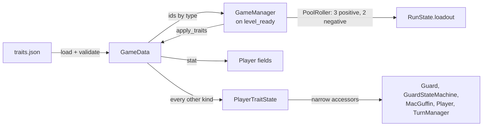

# Traits and GameData

Every run deals the goblin **3 positive and 2 negative traits**, picked at random. They're shown on a reveal screen before the first move, and the player can review them at any time with **C**. Traits change how the goblin plays: how much noise a step makes, how far it can see, how forgiving guards are, and odd luck like stumbles and sneezes.

## How it works

A trait is pure data: an entry in [`project/data/traits.json`](../../project/data/traits.json) with an `effect` that has a **kind** (one of six) plus that kind's parameters. The full definitions and the schema live in [design/traits.md](../design/traits.md). This page covers how that data becomes gameplay.

1. **Load.** At startup, `GameData` reads `traits.json` and checks each effect's kind and property name against an authored list of known names. Anything unrecognized is logged with `Log.error` and dropped, so a typo can't slip through as a trait that silently does nothing ([0001](../decisions/0001-trait-effects-use-authored-dispatch.md)).
2. **Roll.** When the level is ready, `GameManager` asks `GameData` for every valid positive and negative id, and `PoolRoller` picks 3 and 2 distinct ones ([0004](../decisions/0004-traits-rolled-at-run-start.md)). The picks are stored on `RunState.loadout`. `RunStartModal` lists them by name and blocks input until the player confirms with Enter or Space.
3. **Apply.** `GameData.apply_traits()` sends each effect through a `match` on its kind and property:
   - `stat` effects write straight into a `Player` field, once.
   - Every other kind is stored in `Player.traits`, a `PlayerTraitState`.
4. **Read.** Gameplay never asks "does the player have trait X?" Each place a trait matters makes one narrowly named call, like `traits.inner_range_modifier()`, and gets back a number or a yes/no ([0002](../decisions/0002-trait-logic-behind-narrow-accessors.md)).

Restarting (**R**) reloads the scene, which builds a fresh `Player` and `PlayerTraitState` and rolls a new loadout.

### The six effect kinds

| Kind | Stored as | Takes effect in | Traits |
|---|---|---|---|
| `stat` | A `Player` field: `noise_radius`, `smell_radius`, `throw_range`, `fov.max_range`, `fov.min_range` | Whatever already uses that field | Padfoot, Two Left Feet, Keen Eyes, Nearsighted, Far-Sighted, Smelly, Pitcher, Butterfingers |
| `detection_modifier` | Offsets and a suppression switch | Guard vision and detection | Camouflage, Big Target, Cold Trail, Persistent Trail, Vanishing Act, Statue |
| `flag` | Yes/no switches | MacGuffin pickup, waiting, the MacGuffin compass | Cat Burglar, Fidgety, Treasure Hound |
| `charge` | Limited-use counts | Capture and detection | Slippery, Disguise |
| `chance` | Odds plus an outcome, rolled on a trigger ([0003](../decisions/0003-chance-effect-kind.md)) | Moving (Clumsy) and ending a turn (Allergies, Narcolepsy) | Clumsy, Allergies, Narcolepsy |
| `perception` | A radius | Guard visibility through walls | Eavesdropper |

A few traits do more than adjust a number:
- **Statue:** a guard's outer cone ignores you on any turn you waited.
- **Disguise:** absorbs one whole sighting. While you're in any cone, guards don't escalate. The charge is spent on the first turn you're fully clear of all cones. It does nothing once the world is in ALERT, the permanent alarm state that every guard switches to once the player is properly spotted.
- **Treasure Hound:** a small marker on the goblin's edge, in one of eight directions, points toward the MacGuffin until it's picked up.
- **Eavesdropper:** guards behind walls within radius 6 show as a `?`. It uses the same corner-wrapping flood fill as sound, so it reveals that *something* is there, not which guard or what state it's in.
- **Allergies:** each turn the player spends has a 1-in-25 chance of a sneeze. The sneeze alerts guards within 10 tiles, shows the trait's `text` ("ACHOO!") as loud red floating text, and shakes the goblin ([0005](../decisions/0005-turn-end-chance-rolls-every-spent-turn.md)).
- **Narcolepsy:** each turn the player spends has a 1-in-50 chance of falling asleep for 3 turns. While asleep, every move or wait input spends a turn in place instead, each showing the trait's `text` (`*snooze*`) ([0020](../decisions/0020-sleeping-turns-wait-for-input.md); mechanics in [turn-and-grid](turn-and-grid.md#sleeping)).

Every `on_turn_end` chance rolls independently. `check_on_turn_end_chance_effects()` returns a `TurnEndChanceOutcome` with fields for each outcome type: the burst radius and text, and the sleep length and text. Anything that didn't fire stays 0 or empty.

## Key pieces

| Piece | Where | Role |
|---|---|---|
| `GameData` | [`autoloads/game_data.gd`](../../project/autoloads/game_data.gd) | Loads and validates definitions, gives the rollable ids by type, and applies effects through the authored dispatch |
| `PlayerTraitState` | [`util/actors/player/player_trait_state.gd`](../../project/scripts/util/actors/player/player_trait_state.gd) | Holds every non-`stat` effect and exposes the narrow accessors |
| `GameManager._on_level_ready()` | [`autoloads/game_manager.gd`](../../project/autoloads/game_manager.gd) | Rolls the loadout, applies it, and emits `GameEvents.loadout_rolled` |
| `PoolRoller` / `RunLoadout` | [`util/pool_roller.gd`](../../project/scripts/util/pool_roller.gd), [`util/run_loadout.gd`](../../project/scripts/util/run_loadout.gd) | Generic "pick N distinct ids" roller, and the record of this run's picks |
| `RunStartModal` / `TraitsModal` | [`ui/run_start_modal.gd`](../../project/scripts/ui/run_start_modal.gd), [`ui/traits_modal.gd`](../../project/scripts/ui/traits_modal.gd) | The reveal screen (names only), and the **C** screen (press a number for a trait's description) |
| `TurnEndChanceOutcome` | [`util/actors/player/turn_end_chance_outcome.gd`](../../project/scripts/util/actors/player/turn_end_chance_outcome.gd) | What fired on a turn-end roll: fields for each `on_turn_end` outcome type |
| `TreasureHoundIndicator` | [`util/actors/player/treasure_hound_indicator.gd`](../../project/scripts/util/actors/player/treasure_hound_indicator.gd) | Picks which of the eight direction markers to show |

Where gameplay reads traits:

| Accessor | Called from |
|---|---|
| `inner_range_modifier()` | `Guard.compute_vision()` |
| `is_outer_zone_suppressed()`, `has_disguise_charge()`, `mark_seen_this_turn()`, `tracking_memory_modifier()`, `search_hops_modifier()` | `GuardStateMachine.check_immediate_sighting()` |
| `resolve_disguise_turn()` | `TurnManager.run_world_turn()`, once per full turn |
| `try_consume_capture_charge()` | `Guard.interact()` and `Player.interact()` |
| `chest_opens_on_adjacent()` | `MacGuffin.on_proximity_changed()` |
| `emits_noise_while_waiting()` | `Player.wait()` |
| `check_on_move_chance_effects()` | `Player.move_to()` |
| `check_on_turn_end_chance_effects()` | `Player.end_turn()` |
| `reveals_macguffin_direction()` | `Player._update_treasure_hound_indicator()` |
| `eavesdrop_radius()` | `Guard._is_eavesdropped()` |
| `get_applied_ids()` | `TraitsModal` |

## Extending it

- **A new trait using an existing kind and property** is data only. Add the entry to `traits.json` and to [design/traits.md](../design/traits.md); it joins the roll pool automatically. Text, numbers and odds belong in the JSON, not in code (e.g. Allergies' `"text": "ACHOO!"`).
- **A new property, flag, trigger or outcome on an existing kind** takes four touches:
  - its name in the matching `KNOWN_*` list in `GameData`;
  - one line in that kind's `_apply_*` dispatch;
  - one narrowly named accessor on `PlayerTraitState` (for a new `on_turn_end` outcome: fields on `TurnEndChanceOutcome` and a roll in `check_on_turn_end_chance_effects()`);
  - one call at the gameplay site.

  Add a row to the Property/Parameter Reference table in [design/traits.md](../design/traits.md).
- **A new effect kind** means a validation branch, an `_apply_<kind>` function and its accessors. It's a design-level change, so record a decision for it.

## Gotchas

- **Dropped traits are easy to miss.** If you edit `traits.json` and a trait never shows up, check the log: it failed validation and fell out of the pool.
- **`stat` effects are applied once, at run start.** Nothing re-reads trait data mid-run.
- **Cat Burglar is orthogonal only.** It opens the chest on `Proximity.ADJACENT`, which only counts orthogonal neighbors. Passing diagonally doesn't trigger it.
- **Guards assume one player.** They read the player's traits through `GridManager.get_player()`.

## Not built yet

- **Throwing:** Pitcher and Butterfingers write `throw_range`, but nothing reads it until throwing and equipment exist.
- **Equipment rolling:** `Constants.STARTING_ITEM_COUNT` (3) is reserved. Items should reuse `PoolRoller` and extend `RunLoadout` with `item_ids`.
- **Tuning:** most values are starting points, not playtested. See [design/traits.md → Open Items](../design/traits.md#open-items).

---
*Last verified against code: `523d19e` (+ the Narcolepsy branch) on 2026-10-28.*
